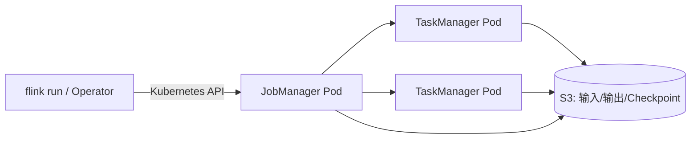

# 在 Kubernetes 上运行 Apache Flink

本文按 [Spark on Kubernetes 教程](../spark-on-k8s/README.md)的结构介绍 Flink，方便逐节对照：先看组件，再准备环境和镜像，配置 Kubernetes/S3 权限，编写作业，最后提交和排错。示例以 Flink 原生 Kubernetes Application Mode 为主；配置项和 S3 插件要与实际 Flink 版本匹配。

## 1. 先理解组件如何配合

Flink 原生 Kubernetes 集成会通过 Kubernetes API 创建 Flink 所需资源：

1. `flink run` 或 Flink Kubernetes Operator 向 Kubernetes 提交应用。
2. Kubernetes 启动 **JobManager Pod**。JobManager 协调作业、调度任务并管理 checkpoint 等运行状态。
3. JobManager 创建 **TaskManager Pods**；TaskManager 提供 task slots 并执行数据处理任务。
4. 作业完成后，TaskManager 和应用集群按部署模式及清理策略退出。

Flink 的 JobManager/TaskManager 是 Flink 自己的运行时角色，不是 Kubernetes 的 master/worker。



### 用 Spark 来理解 Flink

如果你熟悉 Spark，可以用这些概念对照。它们只是在职责上相似，不代表内部实现相同。

| 对比点 | Spark on Kubernetes | Flink on Kubernetes |
|---|---|---|
| 作业协调者 | **Driver**：生成执行计划、调度任务、管理 executors | **JobManager**：调度作业图、协调检查点、管理 TaskManagers |
| 分布式执行进程 | **Executors**：运行 Spark tasks、缓存数据 | **TaskManagers**：运行 Flink operators/tasks，并提供 task slots |
| 简单类比 | Driver ≈ JobManager；Executor ≈ TaskManager | 同左，仅为职责类比 |
| 提交入口 | `spark-submit`；Kubernetes cluster mode 在集群内运行 Driver | `flink run --target kubernetes-application`；也可使用 Flink Kubernetes Operator |
| 作业组织 | 每个应用一个 Driver；可选择 cluster/client deploy mode | Application Mode 为应用建立独立集群；Session Mode 让多个作业共享长期运行的集群 |
| 编程抽象 | DataFrame、Spark SQL、RDD、Structured Streaming | DataStream API、Table API、Flink SQL |
| 流处理直觉 | Structured Streaming 常按微批次处理持续输入，具体能力取决于版本和算子 | 面向持续运行的数据流；事件时间、watermark 和有状态处理是核心概念 |
| 状态与恢复 | Structured Streaming 用 checkpoint 保存查询进度/状态；端到端语义取决于 source/sink | Checkpoint 保存作业状态以故障恢复；端到端语义同样取决于 source/sink |
| S3 访问 | 常见方式是 Hadoop S3A，使用 `s3a://` | 使用 Flink S3 filesystem plugin；URI 和实现取决于 Flink 版本/插件 |

例如持续统计用户活动：Spark Structured Streaming 常见做法是以微批次处理新数据；Flink 常见做法是让作业持续运行，逐事件更新状态，并按 event time/watermark 处理迟到事件。两者都能做批处理和流处理，选择应看延迟、状态和事件时间需求，而不只是产品名称。

### Application Mode 和 Session Mode

- **Application Mode**：一个应用独占一个 Flink 集群，作业入口在集群内启动。适合需要隔离的应用。
- **Session Mode**：先启动长期运行的 Flink 集群，再向它提交一个或多个作业。适合共享资源，但多个作业共享集群资源和故障域。

## 2. 前置准备

- 可用的 Kubernetes 集群和 `kubectl` 配置。
- 提交身份能创建/查看所需 Kubernetes 资源；JobManager 的 ServiceAccount 具有创建和观察作业 Pods、Services、ConfigMaps 等资源的 RBAC 权限。
- 节点能够拉取 Flink 镜像，JobManager 与 TaskManager 网络互通。
- 作业 JAR、Flink 版本和 connector/plugin 依赖兼容。
- 如需访问 S3，准备 bucket、Region、受限 IAM role，以及适用于当前 Flink 版本的 S3 filesystem plugin。

### 2.1 选择与验证 S3 filesystem plugin

Flink 的 S3 文件系统由 Flink plugin 提供，而不是 Spark 的 Hadoop S3A 配置。不同 Flink 版本提供的实现、稳定性和能力可能不同；选择前要确认目标用途（普通读写、FileSink、checkpoint/savepoint）在该版本受支持。

即使选择基于 Hadoop 项目的 Flink S3 plugin，也不需要部署 Hadoop 集群。按对应 Flink 发行版文档使用其 plugin JAR 和目录结构；不要把 Spark 镜像中的 S3A JAR 直接复制过来。Flink S3 URI scheme 也依实现而异，以下例子使用 `s3://`，应按选定插件文档确认。

## 3. 准备作业镜像

Application Mode 的一种常见方式是将作业 JAR、连接器及 S3 plugin 放入 Flink 镜像，使 JobManager 和 TaskManager 都能加载一致的依赖。

```dockerfile
ARG FLINK_IMAGE=flink:<固定且验证过的版本标签>
FROM ${FLINK_IMAGE}

RUN mkdir -p /opt/flink/usrlib
COPY target/my-flink-job.jar /opt/flink/usrlib/my-flink-job.jar

# 如需 S3，将与此 Flink 版本匹配的官方 S3 plugin
# 放入该版本文档规定的 plugins 子目录。
```

构建并推送到 Kubernetes 节点可访问的镜像仓库：

```bash
docker build -t registry.example.com/data/my-flink-job:1.0 .
docker push registry.example.com/data/my-flink-job:1.0
```

生产环境建议固定镜像 tag 或 digest，确保 JobManager 和 TaskManager 使用同一兼容镜像。不要在 Dockerfile、源码或镜像层写入 AWS 密钥。

## 4. 配置 Kubernetes 权限和 S3 身份

Kubernetes RBAC 和 AWS IAM 是两套独立权限：前者决定 JobManager 能否创建 Flink Pods，后者决定 Flink 进程能否读写 S3。

### 4.1 JobManager 的 Kubernetes API 权限

建议使用专用 namespace、ServiceAccount 和 namespace 范围的最小权限。下面是 RBAC 结构示意，实际资源和 verbs 应按 Flink 版本、启用功能及组织策略核实：

```yaml
apiVersion: v1
kind: Namespace
metadata:
  name: analytics
---
apiVersion: v1
kind: ServiceAccount
metadata:
  name: flink-runtime
  namespace: analytics
---
apiVersion: rbac.authorization.k8s.io/v1
kind: Role
metadata:
  name: flink-jobmanager
  namespace: analytics
rules:
  - apiGroups: [""]
    resources: ["pods", "services", "configmaps"]
    verbs: ["create", "get", "list", "watch", "delete"]
---
apiVersion: rbac.authorization.k8s.io/v1
kind: RoleBinding
metadata:
  name: flink-jobmanager
  namespace: analytics
subjects:
  - kind: ServiceAccount
    name: flink-runtime
    namespace: analytics
roleRef:
  apiGroup: rbac.authorization.k8s.io
  kind: Role
  name: flink-jobmanager
```

不要给 Flink 运行时 `cluster-admin`。提交前用 `kubectl auth can-i` 验证实际需要的权限；HA、Operator 或其他功能可能要求额外资源权限。

### 4.2 JobManager 和 TaskManager 访问 S3 的身份

在 EKS 上，推荐把权限受限的 IAM role 关联到 Flink Pods 使用的 Kubernetes ServiceAccount（IRSA）；IAM trust policy 应限制到预期的集群、namespace 和 ServiceAccount。将正确的 ServiceAccount 配置给 JobManager 和 TaskManager，并确认所选 Flink S3 plugin 的 AWS credential provider 支持该工作负载身份。

TaskManager 常执行文件读写和 checkpoint，因此不能只验证 JobManager 能访问 S3。用 bucket/prefix 最小权限区分输入读取、结果写入和 checkpoint 存储。非 EKS 集群使用其 Workload Identity 方案；避免把长期 access key/secret key 放进镜像、作业参数、Git 或日志中。

## 5. 编写一个 S3 读写作业

Flink 有官方 Python API，叫 **PyFlink**，提供 DataStream API 和 Table API。前一版示例用 Java 只是示例语言的选择，并不是 Flink 没有 Python API。

下面用 PyFlink Table API/SQL 与 [Spark 教程](../spark-on-k8s/README.md)里的 PySpark 示例做**同一件事**：读取包含 `event_type` 的 Parquet 事件数据，过滤 `event_type` 为空的行，按事件类型计数，再将结果写成 Parquet 到 S3。区别只是 Spark 使用 DataFrame API，而 Flink 使用 Table API/SQL。

```python
from pyflink.table import EnvironmentSettings, TableEnvironment

settings = EnvironmentSettings.in_batch_mode()
table_env = TableEnvironment.create(settings)

table_env.execute_sql("""
    CREATE TABLE events (
        event_type STRING
    ) WITH (
        'connector' = 'filesystem',
        'path' = 's3://<input-bucket>/events/',
        'format' = 'parquet'
    )
    """)

table_env.execute_sql("""
    CREATE TABLE event_counts (
        event_type STRING,
        event_count BIGINT
    ) WITH (
        'connector' = 'filesystem',
        'path' = 's3://<output-bucket>/results/',
        'format' = 'parquet'
    )
    """)

table_env.execute_sql("""
    INSERT INTO event_counts
    SELECT event_type, COUNT(*) AS event_count
    FROM events
    WHERE event_type IS NOT NULL
    GROUP BY event_type
    """).wait()
```

这是 API 逻辑示例，不是完整部署包：需要在运行环境中安装与 Flink 版本匹配的 PyFlink、Python 运行时、Table/SQL、FileSystem、Parquet 格式依赖及 S3 filesystem plugin；JobManager 和 TaskManager 都必须能使用相同兼容依赖。`s3://` scheme 也要与所选 Flink S3 plugin 相匹配。Spark 示例用 `spark.read.parquet(...).filter(...).groupBy(...).count()` 表达相同转换；两种 API 和运行时不同，但输入、过滤条件、聚合和输出格式一致。

S3 也可作为 checkpoint/savepoint 存储；有状态作业上线前要验证 checkpoint 成功，并实际测试故障恢复。

S3 是对象存储，不是 POSIX 文件系统。不要假定目录 rename 原子；使用 FileSink 时确认所选 plugin 的提交协议、checkpoint、取消/重启及并发写行为。建议按作业版本或批次写入隔离的输出前缀。

## 6. 提交 Flink 作业

### 6.1 Application Mode

从能访问 Kubernetes API 的环境运行 Flink CLI。作业 JAR 已放在 Flink 镜像的 `usrlib` 目录，因此用 `local:///` 指向镜像内路径：

```bash
./bin/flink run \
  --target kubernetes-application \
  -Dkubernetes.cluster-id=my-flink-app \
  -Dkubernetes.namespace=analytics \
  -Dkubernetes.container.image=registry.example.com/data/my-flink-job:1.0 \
  local:///opt/flink/usrlib/my-flink-job.jar
```

`kubernetes.cluster-id` 应唯一。ServiceAccount、资源、checkpoint 和高可用参数应按当前 Flink 版本配置。不同版本的配置键可能变化，提交前查对应版本的官方配置文档。

上面这个提交命令以 Java JAR 作业为例。PyFlink 也可以运行在 Kubernetes 上，但要将 Python 和匹配版本的 PyFlink 运行时放进作业环境，并按所用 Flink 版本支持的 Python 作业提交方式提供入口脚本；不要把 Java JAR 示例误当成 Flink 只能使用 Java。

### 6.2 Session Mode

Session Mode 先部署并保持一个 Flink 集群，再向该集群提交作业。可用 Kubernetes Service 暴露 JobManager REST endpoint，然后通过 Flink CLI 将作业提交到该地址。Session Cluster YAML、Service 名称和 CLI 参数请按所用 Flink 版本官方示例配置。与 Application Mode 相比，Session Mode 的多个作业共享集群资源与故障域。

### 6.3 使用 Flink Kubernetes Operator

原生 Kubernetes 部署负责启动 Flink 集群和作业；长时间运行的作业还需管理失败恢复、升级、savepoint、回滚和扩缩容。Flink Kubernetes Operator 通过自定义资源声明期望状态并持续协调，适合把这些生命周期操作纳入 Kubernetes 管理。

Operator 需单独安装，版本与 Flink 版本有兼容矩阵。生产使用时固定兼容版本，并明确升级、状态迁移和恢复策略；不要只依赖 Kubernetes 重启 Pod 来代替 Flink 状态管理。

## 7. 查看作业和排错

```bash
kubectl get pods -n analytics
kubectl get services -n analytics
kubectl describe pod <jobmanager-pod> -n analytics
kubectl logs <jobmanager-pod> -n analytics
kubectl get events -n analytics --sort-by=.lastTimestamp
```

可通过 Flink CLI 查看和取消 Application Mode 作业：

```bash
./bin/flink list \
  --target kubernetes-application \
  -Dkubernetes.cluster-id=my-flink-app

./bin/flink cancel \
  --target kubernetes-application \
  -Dkubernetes.cluster-id=my-flink-app \
  <job-id>
```

| 现象 | 优先检查 |
|---|---|
| JobManager 无法创建 TaskManager | ServiceAccount/RBAC、namespace、资源配额和 Kubernetes events |
| Pod 一直 Pending 或 ImagePullBackOff | CPU/内存请求、节点容量、镜像 tag 与仓库拉取权限 |
| 找不到 S3 filesystem | 插件目录、插件 JAR 与 Flink 版本、JobManager/TaskManager 日志 |
| 作业启动后无法读写 S3 | URI scheme、Region、IAM role、bucket/KMS policy，以及 TaskManager 身份 |
| Checkpoint 失败 | checkpoint 路径、TaskManager S3 权限、网络和插件能力 |
| 重启后状态丢失 | checkpoint 是否成功、恢复配置和 savepoint/checkpoint 路径 |

排障时先查看 Pod 状态、Flink Web UI、日志和 checkpoint 指标。不要把密钥或凭证环境变量输出到日志；生产环境不要未经认证就把 Web UI 暴露到公网。

## 8. 部署检查清单

- [ ] Flink 镜像 tag/digest 固定，JobManager 和 TaskManager 使用兼容镜像。
- [ ] S3 plugin 与 Flink 版本匹配，功能满足读写、FileSink 或 checkpoint 的需求。
- [ ] JobManager ServiceAccount 只拥有作业需要的 Kubernetes API 权限。
- [ ] JobManager 和 TaskManager 均使用受限的 Workload Identity，可访问所需 S3 bucket/prefix。
- [ ] 没有把长期密钥写入代码、Flink 配置、命令行、镜像或日志。
- [ ] 作业已验证 checkpoint、故障恢复和 S3 输出提交行为。
- [ ] 网络允许 JobManager/TaskManager 互通、访问 Kubernetes API、镜像仓库和 S3 endpoint。
- [ ] 已设置资源请求/限制、namespace 配额、日志保留和作业清理策略。

## 参考资料

- [Apache Flink: Native Kubernetes](https://nightlies.apache.org/flink/flink-docs-stable/docs/deployment/resource-providers/native_kubernetes/)：原生 Kubernetes 部署及 Application Mode。
- [Apache Flink: Kubernetes Setup](https://nightlies.apache.org/flink/flink-docs-stable/docs/deployment/resource-providers/standalone/kubernetes/)：Session Cluster 部署说明。
- [Apache Flink Kubernetes Operator: Overview](https://nightlies.apache.org/flink/flink-kubernetes-operator-docs-main/docs/concepts/overview/)：Operator 与 Flink 生命周期管理。
- [Apache Flink: Amazon S3](https://nightlies.apache.org/flink/flink-docs-stable/docs/deployment/filesystems/s3/)：S3 filesystem 实现、插件和凭证配置。
- [Amazon EKS: IAM roles for service accounts](https://docs.aws.amazon.com/eks/latest/userguide/iam-roles-for-service-accounts.html)：EKS 工作负载身份。
