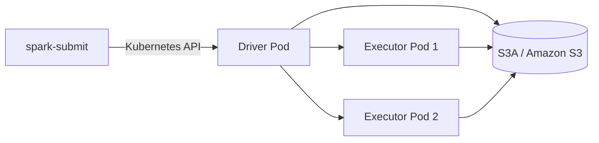

# 在 Kubernetes 上运行 Spark 并读写 Amazon S3

本文用一个批处理例子介绍如何在 Kubernetes（K8s）上运行 Apache Spark，并通过 Hadoop S3A connector 读取、处理和写入 Amazon S3。示例以 Spark on Kubernetes 的 **cluster deploy mode** 为主，身份认证用 Amazon EKS 的 IAM Roles for Service Accounts（IRSA）说明；其他 Kubernetes 云平台可替换为对应的 Workload Identity 机制。

示例里的镜像、命名空间、bucket 和角色名都是占位值。实际部署时要根据集群和 Spark 发行版替换，并确认网络、权限及组件版本兼容。

如果你更熟悉 Flink，可先看 [Flink 与 Spark 的概念对照](../flink-on-k8s/README.md#用-spark-来理解-flink)。

关于测试/生产环境隔离、Node/Pod Affinity、资源池、配额、监控与 DAG 编排，另见[生产环境管理指南](./production-operations.md)。

## 1. 先理解组件如何配合

Spark on Kubernetes 不是在一个长期运行的 Spark Master/Worker 集群中提交作业。使用 `spark-submit` 以 cluster mode 提交时：

1. `spark-submit` 将作业提交给 Kubernetes API。
2. Kubernetes 启动一个 **driver Pod**。Driver 负责协调 Spark 作业，并向 Kubernetes 创建 executor Pods。
3. **executor Pods** 执行分布式计算；driver 和 executors 都需要能够访问作业输入/输出所需的 S3 对象。
4. 作业完成后，executor Pods 退出；driver Pod 会保留为已完成状态，便于查看日志，之后可按集群策略清理。

Spark 通过 Hadoop 的 **S3A connector** 访问对象存储。应用使用 `s3a://bucket/path` URI；它不是 POSIX 文件系统，不能依赖目录原子重命名等传统文件系统语义。



## 2. 前置准备

需要准备：

- 可用的 Kubernetes 集群，以及有权限创建和查看作业资源的 `kubectl` 身份。
- 可从提交端访问的 Kubernetes API server 地址。
- Spark 镜像仓库。Driver 和 executor 都必须能拉取同一个兼容的 Spark 应用镜像。
- S3 bucket、AWS Region，以及只允许访问作业所需 bucket/prefix 的 IAM 权限。
- 互相兼容的 Spark、Hadoop、`hadoop-aws` 和 AWS SDK 依赖。

### 2.1 对齐 Spark、Hadoop 和 S3A 依赖

S3A connector 由 Hadoop `hadoop-aws` 模块提供。**`hadoop-aws` 必须与运行时的 `hadoop-common` 版本完全一致**；它所需的 AWS SDK 依赖也应按该 Hadoop 版本的文档配套。不要把随手下载的不同版本 JAR 混放进镜像，否则容易出现 `NoSuchMethodError`、`ClassNotFoundException` 或 SDK 冲突。

构建镜像前先查看当前 Spark 发行版的 Hadoop 版本，并按该发行版/Hadoop 的依赖说明把 `hadoop-aws` 及相应 AWS SDK 组件加入**driver 和 executor 共用的 Spark 镜像**。如果使用受管 Spark 发行版，应遵循厂商的 connector 兼容矩阵。也可以通过 Spark 的依赖分发机制加载 Maven 包，但运行环境需要能访问包仓库；离线或生产环境通常更适合构建经过锁定和扫描的自定义镜像。

版本升级时，将 Spark、Hadoop/S3A 和镜像作为一个整体验证，避免只替换单个 JAR。

## 3. 准备作业镜像

应用代码既可以放进镜像，也可以在提交时从提交端本地上传。将代码和依赖预装进镜像，适合稳定、重复运行的生产作业；本地上传更适合开发和迭代。以下 Dockerfile 展示预装方式；应固定 Spark 镜像 tag 或 digest，并按前述版本规则加入 S3A JAR：

```dockerfile
ARG SPARK_IMAGE=apache/spark:<固定的版本标签>
FROM ${SPARK_IMAGE}

# 将应用和与 Hadoop 版本匹配的 hadoop-aws / AWS SDK 组件
# 放入 driver 与 executor 共用的镜像。
COPY app.py /opt/spark/app/app.py
```

例如构建并推送到集群可访问的镜像仓库：

```bash
docker build -t registry.example.com/analytics/spark-s3:1.0 .
docker push registry.example.com/analytics/spark-s3:1.0
```

镜像应包含运行作业所需的 Python、Spark、应用依赖和 S3A 运行时依赖。不要在 Dockerfile、源码或镜像层中写入 AWS access key/secret key。

## 4. 配置 Kubernetes 权限和 S3 身份

### 4.1 Driver 的 Kubernetes API 权限

Driver 需要通过 Kubernetes API 创建和观察 executor Pod，以及 Spark 所需的 Service/ConfigMap 等对象。建议在专用 namespace 使用专用 ServiceAccount 和 namespace 范围的最小 RBAC，而不是给 default ServiceAccount 或 driver 集群管理员权限。

以下 RBAC 是基本示例；应按 Spark 版本、启用的功能及集群策略核对实际资源和权限：

```yaml
apiVersion: v1
kind: Namespace
metadata:
  name: analytics
---
apiVersion: v1
kind: ServiceAccount
metadata:
  name: spark-s3
  namespace: analytics
---
apiVersion: rbac.authorization.k8s.io/v1
kind: Role
metadata:
  name: spark-driver
  namespace: analytics
rules:
  - apiGroups: [""]
    resources: ["pods", "services", "configmaps"]
    verbs: ["create", "get", "list", "watch", "delete"]
---
apiVersion: rbac.authorization.k8s.io/v1
kind: RoleBinding
metadata:
  name: spark-driver
  namespace: analytics
subjects:
  - kind: ServiceAccount
    name: spark-s3
    namespace: analytics
roleRef:
  apiGroup: rbac.authorization.k8s.io
  kind: Role
  name: spark-driver
```

应用前可用 `kubectl auth can-i` 验证 driver ServiceAccount 是否具备所需权限；如果启用了额外的 Spark 功能，应据实际资源补充权限，不要直接扩大到 cluster-admin。

### 4.2 Driver 和 executor 访问 S3 的身份

S3 权限与 Kubernetes API 权限是两回事：

- Kubernetes RBAC 决定 driver 能否管理 Spark Pods。
- AWS IAM 决定 Spark 的 driver/executor 能否读写 S3。

在 EKS 上，推荐把一个权限受限的 IAM role 关联到 Kubernetes ServiceAccount（IRSA）。该 role 只授予所需 bucket/prefix 的 `ListBucket`、`GetObject` 和/或 `PutObject` 等权限。下面是 IRSA ServiceAccount annotation 的示意，IAM role 的 OIDC trust policy 也必须允许对应的 cluster、namespace 和 ServiceAccount：

```yaml
apiVersion: v1
kind: ServiceAccount
metadata:
  name: spark-s3
  namespace: analytics
  annotations:
    eks.amazonaws.com/role-arn: arn:aws:iam::<account-id>:role/spark-s3-access
```

Driver 通过 `spark.kubernetes.authenticate.driver.serviceAccountName` 使用这个 ServiceAccount。Executor 也要使用能取得相应 S3 身份的 ServiceAccount；可用 executor Pod template 显式指定：

```yaml
apiVersion: v1
kind: Pod
spec:
  serviceAccountName: spark-s3
```

保存为 `executor-pod-template.yaml`，提交时将它配置给 Spark。需要验证你使用的 Spark 版本及 EKS 配置确实把关联 role 提供给 driver 和 executor，并且镜像中的 S3A/AWS SDK credential provider 支持该 Workload Identity 方式。仅在 driver 上验证成功，不代表 executor 也能访问 S3。

非 EKS 集群应使用对应云平台的 Workload Identity。不得把长期 AWS 密钥放进 Spark 参数、命令行、Git、日志或 Docker 镜像。确实无法使用工作负载身份时，应按组织的 secrets 管理规范提供短期、可轮换凭证，并限制其范围。

## 5. 编写一个 S3 读写作业

`app.py`：

```python
from pyspark.sql import SparkSession
from pyspark.sql.functions import col


spark = SparkSession.builder.appName("s3-parquet-transform").getOrCreate()

source = "s3a://<input-bucket>/events/date=2026-01-01/"
destination = "s3a://<output-bucket>/derived/events/run_id=<unique-run-id>/"

events = spark.read.parquet(source)

result = (
    events.filter(col("event_type").isNotNull())
    .groupBy("event_type")
    .count()
)

result.write.mode("errorifexists").parquet(destination)

spark.stop()
```

将输入、输出 bucket 和路径替换为真实值。输出使用唯一的 `run_id` 路径，可避免重复作业互相覆盖；验证输出后再由下游流程发布或登记该路径。对于生产写入，应按所用 Hadoop 版本配置和验证 S3A output committer，特别是需要可靠任务重试、覆盖或分区提交时。

S3 是对象存储而不是传统文件系统：目录通常是由对象 key 模拟的，rename 不是原子操作，且大规模列举对象可能昂贵。不要把“写临时目录后 rename 成正式目录”当作通用原子发布机制。更稳妥的模式是写入不可变、版本化的输出前缀，完成校验后更新 catalog/manifest 或发布指针。

## 6. 提交 Spark 作业

先准备 executor Pod template：

```yaml
apiVersion: v1
kind: Pod
spec:
  serviceAccountName: spark-s3
```

从可访问 Kubernetes API 的环境运行 `spark-submit`。`<...>` 是需要替换的占位符；命令没有传入 AWS 明文密钥：

```bash
spark-submit \
  --master k8s://https://<kubernetes-api-host>:<port> \
  --deploy-mode cluster \
  --name s3-parquet-transform \
  --conf spark.kubernetes.namespace=analytics \
  --conf spark.kubernetes.authenticate.driver.serviceAccountName=spark-s3 \
  --conf spark.kubernetes.container.image=registry.example.com/analytics/spark-s3:1.0 \
  --conf spark.kubernetes.executor.podTemplateFile=./executor-pod-template.yaml \
  --conf spark.executor.instances=2 \
  --conf spark.executor.cores=1 \
  --conf spark.executor.memory=2g \
  --conf spark.driver.memory=1g \
  --conf spark.hadoop.fs.s3a.impl=org.apache.hadoop.fs.s3a.S3AFileSystem \
  local:///opt/spark/app/app.py
```

可以提交提交机本地的应用文件或依赖文件，不要求全部预先放进镜像。区别在于 URI：

- `local:///opt/spark/app/app.py` 表示文件**已经在 Spark 镜像内**，Spark 不会从你的电脑上传它。
- `file:///.../app.py` 或提交端的本地路径表示文件在**提交机上**。Cluster mode 下 driver 在 Kubernetes Pod 内，不能直接读取提交机的磁盘，因此 Spark 需要先把该文件上传到 driver 可访问的 Hadoop-compatible 文件系统，再由集群加载。

例如，把提交机上的本地 JVM JAR 和额外文件上传到 S3A 暂存路径（本地应用 JAR 及 `spark.files`、`spark.archives` 等依赖的 client-side 上传方式见 Spark Kubernetes 文档）：

```bash
spark-submit \
  --master k8s://https://<kubernetes-api-host>:<port> \
  --deploy-mode cluster \
  --name s3-parquet-transform \
  --conf spark.kubernetes.namespace=analytics \
  --conf spark.kubernetes.authenticate.driver.serviceAccountName=spark-s3 \
  --conf spark.kubernetes.container.image=registry.example.com/analytics/spark-s3:1.0 \
  --conf spark.kubernetes.executor.podTemplateFile=./executor-pod-template.yaml \
  --conf spark.kubernetes.file.upload.path=s3a://<staging-bucket>/spark-upload/ \
  --conf spark.executor.instances=2 \
  --conf spark.hadoop.fs.s3a.impl=org.apache.hadoop.fs.s3a.S3AFileSystem \
  --files "/home/me/my-spark-job/reference.csv" \
  --archives "/home/me/my-spark-job/config-bundle.zip#config" \
  --class com.example.BatchJob \
  "file:///home/me/my-spark-job/batch-job.jar"
```

`spark.kubernetes.file.upload.path` 是 Spark 提交客户端上传本地应用资源时使用的远程目录；它不是作业最终输出路径。提交客户端必须能访问 Kubernetes API，也必须有权限写该 S3A 暂存位置；提交端所用 Hadoop/S3A 依赖和身份，与运行中 driver/executor 的 IAM 身份是不同的配置面。IRSA 只会对使用相应 Kubernetes ServiceAccount 的 Pod 生效，不会自动给开发者电脑上的 `spark-submit` 进程授权。可以从带有受限工作负载身份的提交 Pod 运行命令，或先把依赖上传到集群可访问的远程位置。不要把 AWS 密钥放进 `spark-submit` 命令行。

因此，不能把提交机的任意目录路径直接当成 Pod 内路径使用。单个本地文件可以作为应用资源或受支持的依赖参数传入；一个目录及其内容通常应先打包成 ZIP/TAR，再用 `--archives` 解压，或按 Python 作业的打包方式用 `--py-files` 分发 ZIP/`.egg`。`--files` 用于分发文件，不会自动递归上传目录。Spark Kubernetes 对 client-side 资源上传的支持与参数类型、Spark 版本有关；请核对对应版本文档。

PySpark 的主脚本和依赖也可从提交端本地路径提供，但不同 Spark 版本/发行版对 cluster mode 下 Python 主资源的上传和分发方式可能有差异；如果本地 `.py` 主脚本未被该版本自动上传，请将主脚本放入镜像使用 `local:///...`，或先放到 driver 可访问的远程存储再提交。Python 模块依赖可打成 ZIP/`.egg` 后用 `--py-files` 分发。Spark 的 Kubernetes master URL 格式是 `k8s://https://<api-server-host>:<port>`，端口需要显式提供。

## 7. 查看作业和排错

```bash
kubectl get pods -n analytics
kubectl describe pod <driver-pod> -n analytics
kubectl logs <driver-pod> -n analytics
kubectl get events -n analytics --sort-by=.lastTimestamp
```

常见问题：

| 现象 | 优先检查 |
|---|---|
| Driver Pod 一直 Pending | namespace 资源配额、节点 CPU/内存、调度约束、镜像拉取权限 |
| Driver 无法创建 executor | driver ServiceAccount/RBAC、namespace、Kubernetes API 与 DNS |
| `ClassNotFoundException: S3AFileSystem` | `hadoop-aws` 未加入镜像，或 driver/executor 的 classpath 不一致 |
| AWS SDK 类缺失或 `NoSuchMethodError` | `hadoop-aws`、`hadoop-common`、AWS SDK 与 Spark 发行版的依赖版本不匹配 |
| `AccessDenied` | IAM role trust policy、bucket policy、KMS key policy，以及访问的 bucket/prefix |
| Driver 能读 S3，Executor 报凭证错误 | executor Pod 是否使用了正确 ServiceAccount、IRSA/Workload Identity 注入、executor 镜像依赖 |
| 写入变慢或重试后出现提交问题 | S3A committer、分区数量、小文件、multipart upload 配置及输出路径是否被并发作业共享 |

排障时先用 Pod 状态、driver 日志和 Kubernetes events 定位失败环节；不要打印凭证环境变量或把密钥贴进日志。

## 8. 部署检查清单

- [ ] Spark 镜像 tag/digest 固定，driver 和 executor 使用同一镜像。
- [ ] `hadoop-aws` 与 Spark 中的 `hadoop-common` 版本完全匹配，AWS SDK 依赖也兼容。
- [ ] Driver ServiceAccount 只有本 namespace 所需的 Kubernetes API 权限。
- [ ] Driver 与 executor 均使用受限的 Workload Identity，可访问所需 S3 bucket/prefix。
- [ ] 没有将长期密钥写入代码、Spark 配置、命令行、镜像或日志。
- [ ] S3 输入输出使用 `s3a://`，输出采用唯一运行路径，并验证提交器行为。
- [ ] 网络允许 driver/executor 互通、访问 Kubernetes API、镜像仓库和 S3 endpoint。
- [ ] 设置 driver/executor CPU/内存、namespace 配额、作业超时、日志保留和清理策略。

## 参考资料

- [Apache Spark: Running Spark on Kubernetes](https://spark.apache.org/docs/latest/running-on-kubernetes.html)：提交方式、driver/executor、镜像和 Kubernetes 配置。
- [Apache Hadoop: Hadoop-AWS module / S3A](https://hadoop.apache.org/docs/current/hadoop-aws/tools/hadoop-aws/index.html)：S3A 依赖、兼容性、认证与对象存储注意事项。
- [Amazon EKS: IAM roles for service accounts](https://docs.aws.amazon.com/eks/latest/userguide/iam-roles-for-service-accounts.html)：将 IAM role 关联到 Kubernetes ServiceAccount 的工作负载身份方案。
