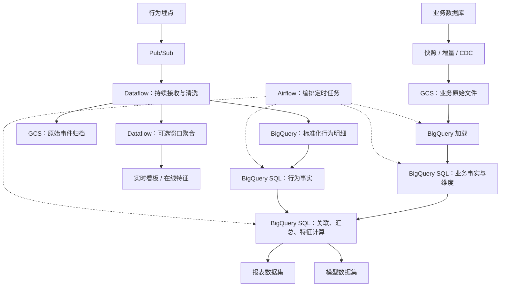

# StubHub 数据平台

本文说明数据库业务数据与行为埋点如何进入数据平台，如何生成业务报表和模型数据，以及 Airflow、BigQuery、Dataflow 分别负责哪些步骤。

目前已确认使用 **Airflow 调度数据流水线**；是否已接入行为埋点、是否运行 Pub/Sub 和 Dataflow 作业，尚未确认。下文以两条明确的示例链路解释架构，不能据此认定所有组件都已在生产使用。表名、频率与在线存储同样是方案示例。

## 1. 总体设计：两类来源、两条示例链路、共同的数仓

### 1.1 为什么分成两条链路

两类数据的根本区别是业务来源和记录语义：

| 比较项 | 数据库业务数据 | 行为埋点数据 |
|---|---|---|
| 来源 | 业务系统执行交易、维护状态或资料 | 客户端或服务端记录用户行为 |
| 示例 | 订单、退款、挂牌、活动、场馆、用户 | 曝光、点击、浏览、搜索 |
| 常见粒度 | 一个实体的记录、一个版本或一次数据库变更 | 一次被记录的行为事件 |
| 变化方式 | 同一主键可能新增、修改、删除，也可能是追加的业务流水 | 通常追加新事件，也需处理重复、更正及删除要求 |
| 正确性重点 | 主键、源变更顺序、删除传播、状态与金额对账 | 事件标识、漏发、重复、乱序、迟到、身份关联 |
| 本文主要用途 | 成交报表、订单状态、库存、业务属性 | 用户路径、转化分析、实时热度、推荐特征 |

来源指业务产生机制，不是存储位置：浏览事件写入数据库后仍然是行为数据，订单 CDC 经消息系统传输后仍然是业务数据。两类数据都可以进入数仓，分别形成订单事实、行为事实等表。

**两类来源都能批处理或实时处理，也都能使用 BigQuery SQL、Dataflow 或 Spark。** 是否使用时间窗口是计算需求，不能作为区分两类来源的标准。

为把工具分工讲清楚，本文固定采用以下示例：

| 示例链路 | 主要执行方式 | 选择原因 |
|---|---|---|
| A：数据库业务数据 | 同步到 GCS，由 Airflow 编排 BigQuery 加载与 SQL | 以定时更新、业务变更合并、关联和汇总为主，结果存放在 BigQuery |
| B：实时行为埋点 | Pub/Sub 接入，Dataflow 持续处理；下游仍由 Airflow 编排 BigQuery SQL | 示例需要持续消费事件、处理乱序迟到、生成实时指标 |

这是本文的方案选择，不是数据来源对工具的限制。仅需小时或日报的埋点可以采用链路 A 的批处理方式；有实时业务变更处理需求时，数据库 CDC 也可以交给 Dataflow。

### 1.2 各工具的职责

| 工具 | 在本文中负责什么 | 谁触发或运行 |
|---|---|---|
| 同步工具 / CDC 服务 | 导出历史快照，捕获后续新增、修改和删除 | 批量抽取可由 Airflow 触发；持续 CDC 服务长期运行 |
| GCS | 保存原始快照、变更文件、行为事件及版本化导出 | 同步工具或处理程序读写 |
| Pub/Sub | 接收并传递持续到达的事件消息 | 应用生产消息，Dataflow 消费消息 |
| Dataflow / Beam | 持续清洗行为事件、去重，按需做窗口聚合 | 部署流程或 Airflow 启动；运行后持续处理 |
| BigQuery | 存储明细和分析表，执行 SQL 校验、合并、关联、汇总及特征计算 | 本文的定时加载与 SQL 由 Airflow 提交 |
| Airflow | 管理任务依赖、处理范围、执行状态、重试及下游触发 | 按计划或指定条件运行 DAG |

**Airflow 是编排工具，BigQuery 和 Dataflow 是数据存储或计算服务。** “Airflow 调度 BigQuery”表示 Airflow 提交并跟踪加载或 SQL 作业；数据在存储与计算服务之间流转，不需要通过 Airflow 传递整批数据。



实线表示数据流转，虚线表示调度关系。Dataflow 的启动可以另外由 Airflow 管理，图中未将其画成每日任务的依赖，具体见第 3 章。

## 2. 链路 A：数据库 → GCS → Airflow 编排 BigQuery → 业务报表

这条链路以“上海今天卖了多少钱”为例。**本文采用 BigQuery 执行加载、合并、关联和汇总，Airflow 负责组织这些任务，本链路不依赖 Dataflow。**

### 2.1 首次全量与后续变更怎样入湖

首次通过一致性快照或全量导出，将订单、活动等记录写入 GCS；之后通过可靠增量抽取或 CDC 保存新增、修改、删除。

原始数据需要保留主键、操作类型、源变更顺序或位点、快照时点、抽取时间及批次。快照与增量必须有一致的衔接边界。若只用 `updated_at` 抽取，要处理同时间戳边界、重叠回读及去重，并另行捕获删除。

批量抽取可以由 Airflow 提交并等待结束。持续 CDC 服务则不必每天重新启动，Airflow 检查其文件、完成标记及同步水位，选定一个完整的处理范围。已有 GCS 历史文件可直接加载或回放，不需要重新经过消息系统。

### 2.2 数据库改了记录，GCS 是否覆盖旧文件

假设订单 O1 金额由 600 元改成 580 元：

| 阶段 | 保存方式 | 执行者 |
|---|---|---|
| 业务数据库 | O1 当前金额更新为 580 元 | 业务系统 |
| GCS 快照 | 原文件仍保存 `O1, 600` | 同步工具此前写入的快照 |
| GCS 新变更文件 | 追加类似 `O1, UPDATE, 580, 源位点` 的记录 | CDC / 同步工具 |
| BigQuery `staging` | 加载本批变更，按策略保留明细 | Airflow 提交 BigQuery 加载任务 |
| BigQuery 当前状态表 | 按主键及源顺序将 O1 合并为 580 元 | Airflow 提交 SQL `MERGE` |
| 报表表 | 刷新受影响的日期和分组 | Airflow 提交汇总 SQL |

**本方案在 GCS 追加变更文件，在 BigQuery 更新当前状态。** 600 和 580 是同一笔订单的不同状态，不是两笔成交。删除同样通过删除标记传播；重试与乱序到达时，按源顺序及主键幂等合并，避免重复计算或旧状态覆盖新状态。实际 CDC 字段取决于工具及配置，不一定包含完整的修改前后记录。

GCS 可以用同名对象替换整个文件，但普通文件不能按主键修改其中一行。如果希望直接读取湖中最新状态，可以合并旧快照与变更、生成新快照供下游切换，或采用 Iceberg、Delta Lake、Hudi 等湖表格式及相应引擎。本文使用普通 GCS 文件方案。

CDC 也可以直接同步到支持的 BigQuery 目的地；先写 GCS 是本文为原始留存和回放采用的路径，不是 CDC 的固定要求。

### 2.3 BigQuery SQL 如何生成事实表、维度表与汇总表

事实表记录发生了什么，维度表说明相关对象是什么，汇总表保存算好的业务结果。先明确每张表一行代表什么，即表的“粒度”。

订单明细事实表 `fact_order_item` 一行代表一条订单明细：

| 订单明细 ID | 活动 ID | 票数 | 金额 |
|---|---|---|---|
| O1 | A | 2 | 600 元 |
| O2 | A | 1 | 300 元 |
| O3 | B | 1 | 200 元 |

活动维度表 `dim_activity` 保存活动资料：

| 活动 ID | 活动名称 | 城市 | 类型 |
|---|---|---|---|
| A | 周末演唱会 | 上海 | 音乐 |
| B | 周末篮球赛 | 北京 | 体育 |

假设这些都是今天的购买记录，没有取消和退款。SQL 用活动 ID 关联两张表，再按日期和城市汇总，得到上海 900 元、北京 200 元。O1 更正为 580 元后，重新汇总得到上海 880 元。

| BigQuery 数据层 | SQL 主要做什么 | 粒度示例 |
|---|---|---|
| `staging` | 字段校验、重复识别，保留源变更元数据 | 一条源记录或变更 |
| `curated` 事实表 | 校验业务字段、合并新增修改删除 | 一条订单明细 |
| `curated` 维度表 | 整理属性，维护当前资料或历史版本 | 一个活动或一版活动资料 |
| `marts` | 关联后按业务口径汇总 | 某城市某一天的成交额 |
| `features` | 按实体及预测时点计算特征 | 活动在某时点之前 7 天的成交均价 |
| `ml_feeds` | 配好特征和标签，固定版本并切分数据 | 一个训练或评估样本 |

当前状态表可以更新已有记录；需要历史分析时，应另行保留变更或历史版本。维度可保存 `valid_from`、`valid_to` 和版本键，明确报表使用当前属性还是交易时属性。只有当前快照时，不能还原未曾保存的历史。

### 2.4 Airflow 实际执行什么 DAG

```text
检查本批文件与源水位完整
    → 提交 BigQuery 加载并等待成功
    → 提交质量检查 SQL
    → 提交事实表与维度表合并 SQL
    → 按依赖提交报表、特征和训练数据任务
    → 对账通过后发布
```

Airflow 跟踪每一步的外部作业状态，按策略重试和告警。检查失败时阻止依赖结果发布。安全重跑依赖批次去重、源位点及幂等 SQL，不能仅靠重试设置。历史更正需定位并重新计算受影响的分区；已发布训练快照修正时生成新版本。

### 2.5 什么时候改用 Dataflow 或 Spark

数据库来源的数据也可以采用 `数据库 → CDC → GCS → Dataflow/Spark → BigQuery`，执行清洗、去重、关联和自定义转换，再按方案合并目标状态。若需要持续处理数据库变更，也可以设计流式 CDC 作业。

本文使用 BigQuery SQL，是因为示例中的合并、关联、汇总都在 BigQuery 内完成。已有 Beam/Spark 代码、特定算法或其他计算需求时，可选择相应引擎；仍需自行实现正确的源顺序、删除及幂等语义。Airflow 可以提交这些批作业并等待完成，再触发下游，不能把使用 Dataflow/Spark 误认为不再需要编排。

## 3. 链路 B：行为埋点 → Pub/Sub → Dataflow → 实时指标与数仓

本章是尚待确认的实时方案，回答“刚刚发生了多少浏览、当前活动有多热”。**Dataflow 负责持续事件处理；Airflow 负责可选的作业启动和定时下游；BigQuery 保存明细并执行后续 SQL。**

### 3.1 每条事件由谁处理

| 步骤 | 具体动作 | 执行者 |
|---|---|---|
| 产生事件 | 记录曝光、点击、浏览，附带事件及实体标识 | 客户端或服务端 |
| 接入消息 | 接收和传递持续到达的事件 | Pub/Sub |
| 原始留存 | 保存原始载荷及接收信息，异常数据保留或隔离 | Dataflow 归档分支写 GCS |
| 清洗明细 | 解析、校验、标准化、按事件 ID 去重 | Dataflow 中的 Beam 代码 |
| 保存明细 | 写出标准化事件供后续分析 | Dataflow 写 BigQuery |
| 实时计算 | 按需求维护时间窗口、处理迟到和更新结果 | Dataflow 中的 Beam 代码 |
| 日报与模型数据 | 整理行为事实，关联业务表，汇总或生成样本 | Airflow 编排 BigQuery SQL / 批作业 |

例如收到 `event_id=v1, user_id=U1, activity_id=A, event_time=10:01`，Dataflow 检查必要字段、字段类型及 schema，统一时间及时区，保留事件时间和接收时间，识别重复事件，再输出明细。解析失败不能擅自补造关键值，应保留原始载荷并隔离处理。

这些规则需要在 Beam 代码和数据契约中定义。Dataflow 不自动保证业务正确；流式去重有状态保留范围，超出范围的重复由下游幂等处理兜底。客户端根本没发出的事件，需要源端计数等完整性核对发现。原始归档、明细与实时指标分别监控和重试。

### 3.2 窗口计算是一个可选输出

活动 A 在 10:01、10:03、10:06 各有一次不同的浏览。按左闭右开的 5 分钟窗口，10:00–10:05 为 2 次，10:05–10:10 为 1 次。

如果 10:04 发生的事件直到 10:07 才到达，它仍属于第一个窗口，在允许迟到范围内可以将结果修正为 3 次。作业需定义事件时间、watermark、允许迟到范围及结果触发规则；超出范围的迟到由离线重算修正。

**窗口由持续运行的 Dataflow 作业内部计算，不需要 Airflow 每 5 分钟启动一次任务。** 不做实时统计时，也可以只输出清洗后的行为明细。明细输出不需要等待窗口结束。

窗口结果按活动与窗口边界等键更新，不能把多次输出的累计值重复相加。浏览次数统计事件，浏览人数统计不同用户，不能直接将各窗口去重人数相加作为全天去重人数。显著性检验和因果分析则需单独定义方法。

### 3.3 Dataflow 是否由 Airflow 调度

可以，但不是必须。Dataflow 可由部署流程或 Airflow 启动，需要区分批作业与流作业：

| 作业 | Airflow 如何配合 | 后续任务何时继续 |
|---|---|---|
| 有限范围的 Dataflow 批作业，例如历史回放 | 提交指定输入范围，跟踪执行状态 | 作业完成且结果校验通过后 |
| 长期运行的 Dataflow 流作业 | 可负责启动、确认状态，也可交给独立部署流程 | 启动任务按配置在提交或确认运行后结束，下游按数据就绪条件触发 |

不能把流作业自然结束作为日报的前置条件，也不能把“已启动”当成“某一天的数据已收齐”。DAG 重跑需防止重复启动消费者；部署方案还需明确升级、停止和故障恢复。实现示例及等待配置见 [Airflow 官方 Dataflow 算子文档](https://airflow.apache.org/docs/apache-airflow-providers-google/stable/_api/airflow/providers/google/cloud/operators/dataflow/index.html)，具体行为需核对所用 provider 版本。

运行中的 Dataflow 持续从 Pub/Sub 消费事件，Airflow 不为每一条事件创建任务。

### 3.4 哪些埋点任务仍由 Airflow 和 BigQuery 处理

实时明细进入 BigQuery 后，日报、业务关联和离线特征仍采用定时编排：

```text
Airflow 检查目标时间范围的数据就绪情况
    → BigQuery SQL 整理行为事实并去重
    → BigQuery SQL 关联订单、活动等表
    → BigQuery SQL 生成转化报表或模型特征
    → 校验、对账和发布
```

就绪条件要结合处理水位、源端完整性、迟到策略和对账，发布后允许补数修正。实时输出与 GCS 回放覆盖同一批事件时，按事件 ID 幂等合并。

如果业务只需要小时或日报，可以不使用实时 Dataflow：`行为日志 → GCS → Airflow 编排 BigQuery 加载和 SQL`，也可由 Airflow 启动 Dataflow/Spark 批作业。选择依据是时效和计算需求，而不是“埋点必须流处理”。

## 4. 两条链路怎样共同生成报表

两条链路在 BigQuery 中形成业务事实、行为事实和维度表，再按明确口径关联。成交、取消、支付和退款以业务数据库为权威来源，购买埋点与订单记录是关联关系，不能累计成两笔成交。

| 结果 | 数据与计算方式 | 编排方式 |
|---|---|---|
| 每日城市成交额 | 订单事实关联活动、场馆及日期维度，BigQuery SQL 汇总 | Airflow 定时提交，检查并发布 |
| 曝光—点击—购买转化 | 行为事实关联订单事实，BigQuery SQL 按归因规则计算 | Airflow 等待两类数据就绪后提交 |
| 实时活动浏览量 | Dataflow 持续计算窗口结果，写入看板可读取的存储 | Dataflow 内部持续执行；启动可由 Airflow 管理 |

BI 查询 BigQuery `marts` 表或受控视图，钻取时访问授权明细。实时看板读取实时指标存储，展示更新时间并接受迟到修正；日结报表使用对账、补数后的结果。统一时区、金额、退款、取消和归因规则，并配置 BI 缓存刷新。

退款应明确扣回原交易日还是记在退款日。关联时检查粒度：一条 600 元订单关联两次点击后若直接相加，会误算为 1,200 元，应先确定归因或聚合规则。库存是时点值，不能将每日快照相加。

## 5. 两条链路怎样共同生成模型数据

模型从业务和行为明细出发，生成按实体及预测时点组织的特征、标签和交互数据。报表汇总通常丢失样本粒度，不能直接替代训练数据。

| 用途 | 计算与输出 | Airflow / Dataflow 分工 |
|---|---|---|
| 价格模型 | 挂牌快照、票区属性、历史成交 → 特征与后续成交价格标签 | Airflow 编排 BigQuery SQL 或批作业，固定数据版本 |
| ALS 推荐 | 行为事实 → 用户—活动交互数据 → Spark 训练向量 | Airflow 编排数据准备和 Spark 训练任务 |
| 精排训练 | 曝光明细关联预测时点特征及后续点击、购买标签 | Airflow 编排历史关联及样本生成 |
| 实时热度特征 | 最近时间窗口内的浏览等指标 → 在线特征存储 | Dataflow 持续计算并发布 |
| 批量推理 | 某快照时点的特征 → 批量预测结果 | Airflow 编排特征准备、推理和校验 |

训练样本在预测时点 `t` 只能使用当时已可获得的信息。事后补录但交易时间早于 `t` 的记录，也不能直接当作当时已知特征。维度按历史版本关联，标签在后续目标窗口结束后生成。

记录事件时间、数据可用时间、输入快照、特征定义、标签口径和代码版本，按时间划分训练、验证及测试集。已发布数据集保留版本，修正时生成新版本。

BigQuery 和 GCS 用于离线读取；在线请求从低延迟特征服务获取预计算特征，并结合请求上下文推理。在线特征需带更新时间，明确过期、缺失时的回退方式，并保持线上线下的定义一致。

## 6. 运维与正确性：按职责监控

| 负责层 | 主要检查 |
|---|---|
| 同步与 GCS | 快照边界、源位点、文件与批次完整性、源端对账 |
| Pub/Sub 与 Dataflow | 消息积压、处理延迟、作业健康、重复和异常比例、归档及输出失败 |
| BigQuery | 主键与粒度、合并顺序、质量规则、关联覆盖率、行数金额对账、受影响分区刷新 |
| Airflow | DAG 依赖、处理范围、外部作业状态、超时重试、失败告警、发布条件 |
| 报表与模型服务 | 数据更新时间、版本、指标口径、特征新鲜度及线上线下一致性 |

重放、补数和失败重试遵循与正常处理相同的去重及合并规则。事实按业务或事件日期、快照按快照日期设计分区，并按查询模式评估聚簇。删除和历史修正需传播至相关下游，访问与保留策略覆盖原始层、数仓、报表及模型数据，避免将不必要的身份或支付信息写入模型输入。
