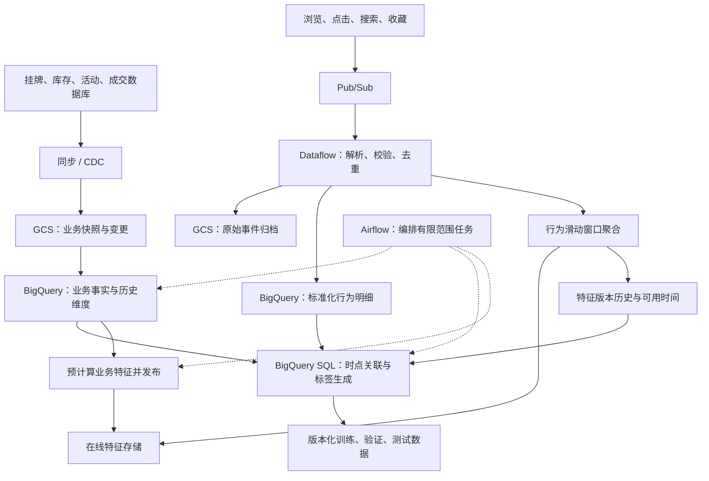

# StubHub 价格预测系统

## 1. 产品目标：建议价格范围与预计成交速度

卖家列票时，系统根据票的属性、市场供给、历史成交和近期用户需求，提供**建议挂牌价格范围，并说明在相应价格下预计多快可以成交**，帮助卖家权衡售价与出售速度。

本文以 **2019 年**为技术时间背景，按“业务数据 + 行为时间窗口特征”的方案说明实现。产品目标来自已有业务背景；具体算法、行为特征、窗口、服务和数值均为设计示例，尚不能认定为当年的实际配置。GCP ML Platform 在本文指当时的 **AI Platform Training / Prediction（前身为 Cloud ML Engine）**。

系统不是仅预测一个未来成交价。可以将其拆成两个相互配合的任务：

| 任务 | 输入与输出 | 作用 |
|---|---|---|
| 价格参考 | 票区、活动、市场等特征 → 同类成交价格估计或条件分位数 | 为候选挂牌价格提供参考 |
| 成交速度 | 票和市场特征 + 候选挂牌价 → 指定期限内售出概率或成交时间分布 | 比较不同价格下的预计出售速度 |

一种实现是成交价回归配合概率或生存模型，也可以采用其他经过验证的方法。普通价格回归不会自动输出售出时间。建议价格范围是产品策略输出，不自动等于统计置信区间；高价挂牌也不一定能赚得更多，因为售出概率和等待时间同样重要。

## 2. 两类数据怎样共同影响建议

**业务数据描述“卖什么、供给多少、过去如何成交”；行为数据描述“最近有多少人在关注和寻找”。**

| 数据来源 | 具体内容 | 对预测的作用 |
|---|---|---|
| 活动及票区资料 | 城市、场馆、活动类型、票区、排位、视野、票种 | 描述票的基本差异 |
| 挂牌与库存 | 挂牌价、票数、竞争挂牌价格、同类库存、改价历史 | 描述当前供给与竞争 |
| 历史交易 | 单张成交价格、成交量、挂牌至成交时长、取消退款 | 提供真实价格及出售结果 |
| 行为事件 | 活动浏览、票区点击、搜索、收藏及有效曝光 | 提供近期需求与关注变化的信号 |

例如两个活动历史价格和库存相近，其中一个最近一小时浏览、搜索和收藏上升，行为特征可能更早反映需求变化。模型是否应因此提高价格建议或缩短预计售出时间，要通过数据学习和评估，不能写成“浏览量上涨必然涨价”的固定规则。

行为也受推荐位置、曝光量、挂牌价和流量渠道影响，浏览量不等于真实购买意愿，更不代表调整价格的因果效果。训练和实验需关注这些偏差。

## 3. 特征设计：属性、状态、时间与窗口

### 3.1 业务特征

| 特征组 | 字段示例 | 计算方法 |
|---|---|---|
| 活动属性 | 活动类型、城市、场馆、演出者或球队、赛事阶段 | 从当时有效的维度资料关联 |
| 票与挂牌属性 | 票区、排位分组、视野、连座数量、票种 | 业务字段标准化与类别编码 |
| 当前市场状态 | 同类有效库存、最低价、中位价、候选价格的市场分位 | 按预测时点的有效挂牌快照计算 |
| 时间特征 | 距开场小时数、挂牌年龄、距上次改价时长、当地星期 | 根据当时已知时间及活动版本派生 |
| 历史成交窗口 | 过去 1 / 7 / 30 天成交量、均价、中位价、价格离散度 | 按活动或同类票区分组，聚合预测时点之前的已知交易 |
| 供给变化窗口 | 过去 1 / 24 小时新增、撤单、改价次数和库存净变化 | 从挂牌变更或历史快照计算 |

“同类”要明确活动、票区、排位和票种等匹配规则。聚合需保留样本数、缺失标志和最近一次观测时间；统计竞争价格时避免将自身挂牌混入。卖家刚开始列票时尚无自定价格，可先生成价格参考，再将候选价格送入速度模型；卖家输入价格后也可以重新评估。

### 3.2 行为时间窗口特征

原始浏览、点击等事件不能直接无限累计，应按实体和过去时间范围聚合，形成模型可读取的字段：

| 特征示例 | 实体与窗口 | 表达什么 |
|---|---|---|
| `activity_views_15m` | 活动，过去 15 分钟 | 短期关注程度 |
| `activity_viewers_1h` | 活动，过去 1 小时去重用户数 | 关注人群规模 |
| `section_clicks_1h` | 活动 + 票区，过去 1 小时 | 对该票区的近期兴趣 |
| `activity_searches_24h` | 活动，过去 24 小时 | 搜索需求；需可靠地将搜索映射到活动 |
| `activity_favorites_24h` | 活动，过去 24 小时新增收藏事件 | 收藏行为变化，不能当作当前总收藏人数 |
| `section_ctr_1h` | 相同票区和展示面，过去 1 小时 | 点击 / 有效曝光，同时保留分子与分母 |
| `views_per_active_listing_1h` | 活动，浏览窗口结合当前有效库存 | 关注与供给的相对强度，处理零库存 |
| `activity_view_trend` | 最近 1 小时与此前可比窗口 | 热度上升或下降；统一窗口长度或先换算速率 |

窗口和字段是示例，需要按事件量、聚合延迟、数据质量及预测增益选择。CTR 低曝光时不稳定，应设置最小样本量或平滑；滑动窗口的去重人数不能用多个小窗口的去重人数直接相加。

**新挂牌没有自身历史行为，不等于无法使用行为数据。** 首次列票时使用活动、票区或其他可比层级的聚合；发布后的持续估价可以再使用该挂牌自己的浏览、收藏和点击。票区样本不足时回退到活动层级，并记录实际使用的层级和覆盖情况。

### 3.3 实时、窗口、业务来源是不同维度

“过去 15 分钟活动浏览量”既是行为特征，也是窗口特征，还可以每分钟更新。“过去 7 天成交均价”是业务成交窗口特征，可以每天或每小时更新。“当前竞争最低价”是时点状态，可以持续更新但不属于窗口聚合。

没有固定的“实时、事实、窗口特征比例”，这些类别不能直接相加。本文使用业务与行为两类特征，但保留不含行为的基线模型，通过消融实验检查行为窗口是否改善价格、速度预测及线上业务效果，不能仅凭特征数量判断价值。

## 4. 一条训练样本怎样构建

一行对应一个挂牌在预测时点 t 的快照。对于速度任务，还要记录当时或待评估的价格；同一挂牌可以有多个时点样本，但要处理样本相关性。

| 字段 | 示例 | 角色 |
|---|---|---|
| `listing_id`, `prediction_time` | L1, t | 样本主键，不直接当数值特征 |
| `event_id`, `section_category` | A, lower_bowl | 关联键与票区特征，活动 ID 需考虑新活动泛化 |
| `ticket_quantity`, `hours_to_event` | 2, 240 | 票数和距开场时间 |
| `price_per_ticket_at_t` | 300 元 | 历史观测的当时挂牌价；速度模型推理时对应候选价 |
| `comparable_active_listings` | 85 | 当时供给 |
| `comparable_sale_median_7d` | 285 元 | 历史成交窗口 |
| `activity_views_15m` | 120 | 行为窗口 |
| `activity_viewers_1h` | 260 | 行为窗口 |
| `section_clicks_1h` | 38 | 行为窗口 |
| `feature_available_time` | 不晚于 t | 特征发布及可读取时间信息，实际可按组或字段记录 |
| `sold_within_7d` | 1 或 0 | 观察窗口完整后生成的速度标签 |
| `sale_price_per_ticket` | 290 元或缺失 | 实际成交价，仅作价格任务标签 |
| `duration`, `event_observed` | 至成交或观察截止的时长、是否成交 | 生存建模标签，保留未售出样本 |

成交价标签统一币种、手续费、单张票及退款取消口径。未成交不能将成交价填成 0。7 天尚未观察完的样本不能直接标记“7 天内未售出”；对未售出、撤单、改价及活动结束需定义删失或竞争事件的处理方式。

历史价格不是随机决定的：卖家定价、活动需求与票质同时影响成交。不能只改样本里的价格字段就生成真实标签，也不能把模型在候选价格下的预测直接解释为调价的因果效果。必要时补充受控实验验证。

### 4.1 按预测时点关联，防止未来信息泄漏

对时点 t 的输入，只使用当时已经可获得的数据。窗口通常是 `[t - W, t)`，但如果行为聚合有发布延迟，训练还需按实际可读的聚合版本取值。10:04 的浏览在 10:07 才被处理，不能用于还原 10:05 的线上请求。

保留事件时间、接收时间、聚合截止时间、可用时间及特征版本。事后补录的交易、补齐的埋点和更新后的活动资料不能无条件覆盖历史输入。在线窗口是哪个版本，离线就应尽量还原哪个版本。

训练、验证、测试按时间划分，标签窗口与后续评估区间避免不当重叠，必要时留出间隔；检查同挂牌跨集合相关性，并单独评估新活动、新票区及行为覆盖不足的场景。标签必须等待成熟后生成。

## 5. 数据链路：Dataflow、BigQuery 和 Airflow 各做什么



| 组件 | 具体职责 |
|---|---|
| 同步工具 | 捕获业务记录的新增、修改和删除，保存主键与源位点 |
| Dataflow / Beam | 持续消费行为事件，处理重复和迟到，按活动及票区生成窗口特征，并发布可用版本 |
| GCS | 保存原始快照、变更与行为事件，支持回放；异常数据同样保留或隔离 |
| BigQuery | 保存业务与行为明细、特征历史，执行业务聚合、历史时点关联和标签生成 |
| Airflow | 检查批次及水位，编排 BigQuery SQL、回放批作业、样本生成、训练及批量预测 |
| 在线特征存储 | 按活动、票区等键低延迟读取已计算的特征及其更新时间 |

窗口需明确滚动长度、更新频率、watermark、迟到容忍和修正规则。Dataflow 不会自动理解这些业务定义，需在 Beam 代码中实现。归档、窗口和明细输出分别监控；历史回放与实时结果按事件 ID 或特征键和版本幂等处理。

Dataflow 流作业可由部署流程或 Airflow 启动，启动后持续运行，不需要 Airflow 每 15 分钟重启来算窗口。Airflow 日常任务等待指定数据范围就绪，不等待流作业自然结束。低实时性需求也可采用 Airflow 编排 BigQuery 或 Spark 批量生成行为窗口，而不是必须使用实时链路。

## 6. GCP ML Platform 怎样训练和部署

### 6.1 训练与调参

Airflow 先生成冻结的数据版本及时间划分，再提交云上训练任务。训练程序读取 BigQuery 授权数据或 GCS 版本化文件，开发者提供代码、依赖、特征 schema、标签定义及模型参数；平台提供资源运行程序，不会自动定义正确的业务目标。

训练代码完成以下步骤：

1. 校验样本唯一性、标签成熟度、特征覆盖率和时点边界。
2. 只在训练集拟合填充、类别编码及标准化等转换，验证和测试应用同一转换。
3. 训练价格参考模型，例如正则化回归、梯度提升或分位数回归；训练售出概率或生存模型作为速度组件。
4. 在验证集选择参数、窗口和特征组；保留测试集用于最终评估。
5. 保存模型、预处理、输入字段顺序、缺失处理、特征版本、数据代码版本及指标。

资源根据算法与数据量配置，不默认需要 GPU。可使用平台调参任务搜索参数，但优化指标、预算和范围需自行设定。若采用平台内部流水线，应明确与 Airflow 的编排边界，避免重复调度。

### 6.2 评估不能只看 RMSE

| 评估对象 | 指标及检查 |
|---|---|
| 价格点预测 | MAE、RMSE，按价格区间、活动、票区和距开场时间切片 |
| 成交价条件分位数 | 分位数损失与覆盖率；不得混同挂牌建议的收益保证 |
| 指定期限售出概率 | LogLoss、Brier score、概率校准，以及区分能力 |
| 成交时间 | 使用能处理删失的评估，如合适的时间依赖指标、综合 Brier score 等 |
| 行为特征增益 | 相同划分和目标下比较有无行为特征，并检查陈旧、缺失和低流量切片 |
| 产品效果 | 通过 A/B 测试评估售出、卖家收益、挂牌完成及投诉等 |

还需测试特征服务故障、全新活动和低数据量场景。离线准确不代表建议价格更赚钱或成交更快，最终按预定义的线上实验目标判断。

### 6.3 模型版本与在线部署

候选模型通过评估门槛后，将模型文件、预处理和元数据保存到版本化 GCS 目录。AI Platform Prediction 使用 model / version 资源管理部署：先创建 model，再创建指向模型产物目录的 version，指定兼容的框架、runtime 和 Python 版本。创建 model 资源本身不会加载模型，version 部署成功后才可调用预测 API；需要验证加载、样例输入、输出和访问权限。

推荐将价格与速度模型分别部署为两个 model，各自管理 version，由业务后端负责预处理、候选价格生成和概率组合。按卖家身份稳定路由到明确的模型版本组合，进行小流量实验和逐步放量；保留旧版本与回滚路径。修改默认 version 不等同于用户级 A/B 实验。

历史能力参考 Google 的 [2018 年 XGBoost 在线预测介绍](https://cloud.google.com/blog/products/gcp/serving-real-time-scikit-learn-and-xgboost-predictions)。具体 runtime、资源规格及框架支持需按 2019 年实际采用月份的配置核实。

### 6.4 具体模型方案：价格回归 + 成交速度模型

XGBoost 的树模型原理与回归代码示例见 [XGBoost 入门](ref/xgboost.md)；排序训练及 GCP 部署流程见 [推荐系统](./recommendation-system.md#3-xgboost-在推荐中负责什么)。

**本文选用一套可具体实现的示例：XGBoost 回归模型提供成交价格参考，另一个基于 XGBoost 二分类器的离散时间风险模型提供成交速度预测。** 这是当前文档的设计选择，并非确认当年已经使用了 XGBoost；两部分使用不同的标签和训练样本，不是一个回归模型自动完成全部功能。

| 模型 | 算法与目标 | 训练标签 | 输出 |
|---|---|---|---|
| 价格参考模型 | XGBoost 回归，例如平方误差目标 | 满足既定条件的实际单张成交价 | 条件成交价格参考值 |
| 成交速度模型 | XGBoost 二分类，训练离散时间条件风险 | 在此前尚未成交且可观察的条件下，是否在当前时间区间成交 | 各区间条件成交概率，再组合为售出时间分布 |

价格模型输入包括活动、票区、距开场时间、同类库存、历史成交窗口和行为需求窗口。它只在具有有效成交价标签的样本上训练，因此存在成交选择偏差，不能保证任何挂牌都能以预测价格售出。平方误差回归倾向估计条件均值；如果使用对数价格，需要额外处理变换后的估计与还原偏差。首次报价不要求卖家先提供价格，不能把未来成交价或最终成交状态作为输入。

速度模型除上述市场特征外，还输入候选挂牌价，以及候选价相对同类价格的位置。示例可按日分段：第 1 天、第 2 天等，直到预设预测上限或活动结束。预测时冻结时点 t 已知的特征，并加入“从 t 起经过的时间区间”；不会使用未来才观测到的浏览量或库存。

训练时把一个预测快照展开成多行“快照 + 时间区间”：成交前的完整可观察区间标记为 0，成交所在区间标记为 1，之后不再产生行；观察结束前未成交的样本保留其完整可观察区间，删失之后不生成虚假的 0 标签。撤单、改价和活动结束可能需要竞争风险或额外建模，不能不加区分地当作独立删失。若要解释为某个候选价格保持不变时的速度，应明确价格暴露及变价处理规则；简单丢弃改价后记录也可能引入偏差。

设模型输出第 k 个区间的条件成交概率为 `h_k`，含义是“之前尚未成交的条件下，在本区间成交的概率”。则截至第 K 个区间仍未售出的概率为 `S_K = ∏(1 - h_k)`，截至该时点的售出概率为 `1 - S_K`。若售出概率首次达到 50%，可以给出对应的中位售出时间；在支持的预测范围内未达到时，应显示未达到或信息不足，不能硬给一个天数。区间展开后的多行并不独立，数据切分和不确定性评估要保留原始挂牌的关联结构。

**建议价格范围由策略层生成，不是直接将回归点预测上下浮动一个比例。** 策略层以价格参考和市场范围生成候选价格，使用速度模型比较每个候选价对应的售出概率，再结合卖家的速度目标、费用和业务约束形成建议。历史数据中的定价存在混杂，候选价格需限制在有数据支持的范围内，并通过实验验证建议策略，不能将预测曲线当作已经证明的调价因果效果。

选择梯度提升树作为示例，是为了处理数值、类别编码、非线性关系及价格与需求的交互。训练中仍需与简单回归和不含行为数据的基线比较；类别编码、概率校准和模型参数只在相应训练/验证数据上拟合。具体采用哪种算法，最终由价格误差、速度校准、推理成本和线上效果决定。

### 6.5 XGBoost 在 GCP 上的具体落地

可以复用 [推荐系统中的 GCP 训练与发布流程](./recommendation-system.md#4-在-gcp-上训练和发布-xgboost)：BigQuery 构建样本，GCS 冻结数据，Airflow 提交 AI Platform Training 的 Python 训练包，评估后创建 AI Platform Prediction 的 model/version。复用的是平台流程，价格与推荐的样本、标签、模型文件和发布门槛分别管理。

| 组件 | XGBoost 配置示例 | GCP 训练与服务注意点 |
|---|---|---|
| 价格参考 | `XGBRegressor(objective="reg:linear", tree_method="hist")` | 使用有效成交价标签；验证集选择轮次，测试集报告 MAE/RMSE 和业务切片 |
| 离散时间成交风险 | `XGBClassifier(objective="binary:logistic", tree_method="hist")` | 使用第 6.4 节展开的区间行，输入包含候选挂牌价及区间编号；划分时保持同一快照的区间行在同一集合 |

为兼容当时的 runtime，价格回归可使用平方误差目标的旧名称 `reg:linear`；支持较新版 XGBoost 的环境也可使用其新名称 `reg:squarederror`。训练与服务需锁定一致的依赖版本。

训练入口将两个模型分别通过 `get_booster().save_model("model.bst")` 导出到不同的本地目录，再上传到不同的 GCS 发布目录，供各自的 model/version 加载。特征顺序、编码、缺失规则、区间边界、校准产物及发布清单另外保存，由业务后端读取和应用。使用提前停止时，可按验证集选出的最佳轮数重新训练并导出，避免旧版服务默认使用停止时的全部树。CPU 可作为起点，不默认需要 GPU。

后端先调用价格模型取得参考，再由策略层生成候选价；对每个候选价展开未来区间并批量调用风险模型。若各区间条件风险为 `h_1, ..., h_k`，则截至第 k 个区间的售出概率为 `1 - product(1 - h_j)`。业务后端负责组合与校准，XGBoost 不会自动把单行二分类结果转换成售出时间分布，不能直接将某一区间的风险当成“7 天内售出概率”。

上线前比较本地与云端的价格及累计概率，检查累计概率随期限不下降、缺失特征处理、低样本候选价和超时回退。价格建议仍由策略层生成，云上部署不会消除第 6.4 节说明的选择偏差与因果限制。

## 7. 卖家列票时怎样得到建议

```text
卖家选择活动、票区、票数
    → 后端读取活动属性、当前供给和历史成交特征
    → 从在线存储读取活动 / 票区行为窗口及更新时间
    → 检查 schema、覆盖率和特征时效
    → 生成候选价格，调用价格与速度模型
    → 策略层结合币种、费用、价格边界及卖家目标
    → 返回建议价格范围及对应的成交速度说明
```

例如界面可以展示几个价格档位及“7 天内售出概率”，数值须来自经过校准的预测。若改为“预计几天售出”，需定义是中位时间、条件期望还是其他量；某价格下预测售出概率不足时，不应强行给出一个有限天数。

在线请求不应临时扫描 BigQuery 大表计算窗口，也不由 Airflow 同步处理。它读取已经发布的特征，再调用模型。特征缺失与陈旧必须有明确处理：回退到更粗粒度聚合或使用单独验证的不含行为模型；不能把埋点故障误填成真实的零浏览。训练时也要覆盖合理的缺失场景，并记录降级标识。

首次列票使用活动和票区级行为；发布后更新建议时，可以加入自身挂牌历史。批量更新一批挂牌时，可由 Airflow 编排离线 Python / Spark 作业，读取 GCS 模型和特征快照执行预测，再校验并发布结果。这条离线路径不依赖在线 model/version，也不假设当时的平台批量预测 API 支持 XGBoost。

## 8. 监控、实验与更新

监控行为接入覆盖、重复、迟到和窗口发布延迟，业务同步水位，在线特征过期缺失，以及模型服务错误率、延迟和资源。分别排查数据故障、特征漂移和模型退化，不能把需求下降与埋点中断混为一谈。

记录预测时点、输入特征版本、候选价格、实际建议、卖家最终选择、模型版本及降级情况。标签成熟后评估价格与速度，未成交样本按相应方法处理，不只统计已售出的票。

用卖家级或经过干扰评估的实验设计比较新旧建议，关注售出表现、卖家收益、建议采纳、取消退款和投诉。采纳行为是处理后的结果，不能只比较采纳建议的卖家；共享库存和竞争定价也可能造成组间干扰，具体见 A/B 测试文档。

重训由计划或明确监控条件触发，Airflow 编排数据版本、训练、评估及发布流程。新模型需重新通过离线、服务和线上实验门槛，不因加入了更多行为特征而自动上线。
